# Microduck 复刻 · SolidWorks 三维图纸与装配说明书

> **可编辑的 SolidWorks 源文件**（不是 STL），外加一份 21 页的装配安装说明书。**两个版本**：
> **v2.2 飞特 HD-1910 版**（2026-10-20，散热孔 + 上腿间隙 + BOM 更新）和 **v1.1 原版 XL330 版**（2026-09-15，踝 / 小腿 / 脚同步改了）。
> 配套主仓：[**fanhao375/microduck-replica**](https://github.com/fanhao375/microduck-replica) —— 整机复刻、电路板与逆向分析都在那边。

> **模型与打印文件统一在本仓库维护（2026-09-28）。** 主仓已移除旧上游 STL 下载副本。请先选择飞特或 XL330 版本，再核对具体附件；两款舵机的配合件不能混用。

> 📦 **压缩包在 [Releases 页](../../releases)（页面右边栏），不在上面的文件列表里。** 418 MB 的 SolidWorks 不适合塞进 git。
> 🖨️ 飞特打印工程见下方[打印说明](#打印)。仓库内 3MF 是 **2026-10-20 版（v2.2 散热孔 + 上腿间隙）**；轮滑变体轮胎见 v2.1 合体轮胎（TPU）。[MakerWorld 工程](https://makerworld.com.cn/zh/models/2963569-microduck#profileId-3478428)由机械行者Robo 上传，页面提供在 Bambu Studio 中打开的飞特版打印配置；是否同步本仓 v2.2 文件仍需核对。

> 📺 **装配视频教程：[B 站合集《MicroDuck 从零安装教程》](https://space.bilibili.com/312747174/lists/9279084?type=season)**，机械行者Robo 一集装一个部件，共 8 集，已更新 6 集 → [分集目录](#装配视频教程)

<div align="center">
  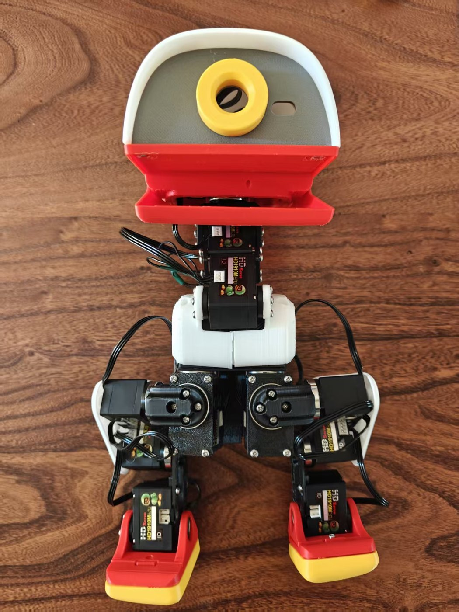
  <br><sub>2026-09-13 · 飞特 HD-1910 版装出来了，15 颗全在位</sub>
</div>

<div align="center">
  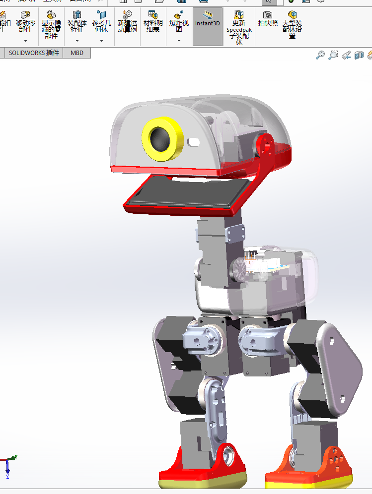
  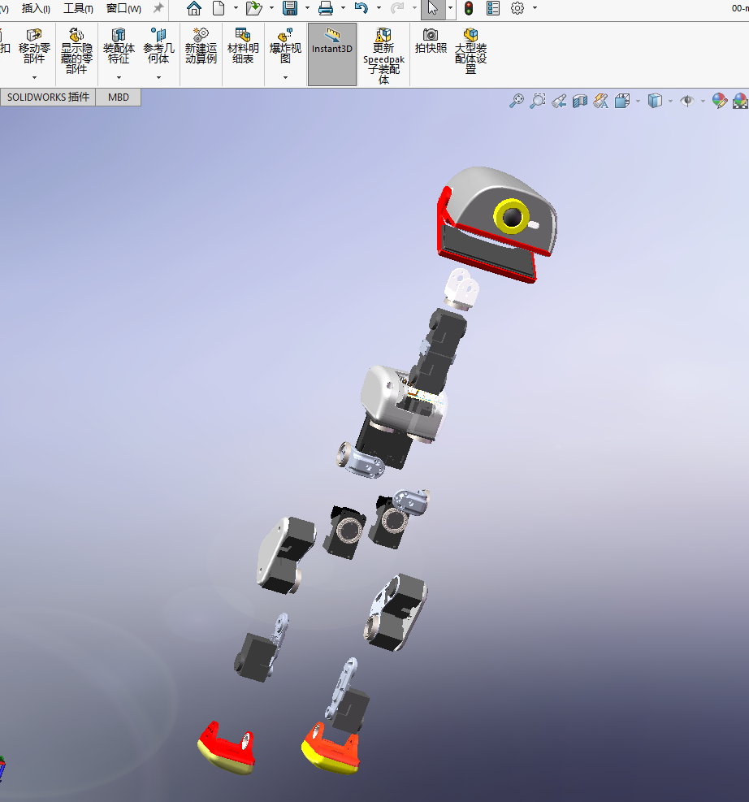
</div>

---

## 两个版本，选一个下

| | 原版 · XL330 · **v1.1** | 飞特 · HD-1910 · **v2.2** |
|---|---|---|
| **舵机** | Dynamixel XL330-M288 | 飞特 HD-1910-C001 |
| **文件** | 57 个 SolidWorks，无后缀 | 77 个 SolidWorks + 13 个 STEP，`-FT` 后缀 |
| **差别** | — | **舵盘凸出**，8 个配合件改了（[改了什么](#飞特-hd-1910-版改了什么)） |
| **打印** | 从 [v1.1 SolidWorks 源文件](https://github.com/fanhao375/microduck-replica-cad/releases/tag/v1.1) 按零件导出 STL 后切片；本仓暂无该版整套打印工程 | [`打印/` 3MF](打印/) 为 **10-20 版**（v2.2 散热孔 + 上腿间隙）；见[版本提示](#打印) |
| **实物** | — | 已装出（上图） |
| **下载** | [`SolidWorks-XL330-v1.1.zip`](https://github.com/fanhao375/microduck-replica-cad/releases/download/v1.1/SolidWorks-XL330-v1.1.zip) 333 MB | [`SolidWorks-FT2026-10-20.zip`](https://github.com/fanhao375/microduck-replica-cad/releases/download/v2.2/SolidWorks-FT2026-10-20.zip) 418 MB（v2.2 · 散热孔 + 上腿间隙） |

两版的踝 / 小腿 / 脚在 2026-09-15 同步成了一套设计；装配说明书和组件图两版通用。

---

## 图纸作者：机械行者Robo

**这套三维图纸和安装说明书，全部由「机械行者Robo」建模、整理、编写。**

装配视频已经在 B 站更新（[分集目录](#装配视频教程)）。装配上有问题，去这几个账号下留言最快：

<table>
<tr>
<td align="center" width="33%">
  <a href="https://space.bilibili.com/312747174"></a><br>
  <b>B 站 · 机械行者Robo</b><br>
  <sub>UID 312747174</sub>
</td>
<td align="center" width="33%">
  <a href="https://www.xiaohongshu.com/user/profile/5ad950114eacab046016f038"></a><br>
  <b>小红书 · 机械行者</b><br>
  <sub>小红书号 270594280</sub>
</td>
<td align="center" width="33%">
  <a href="https://www.douyin.com/user/MS4wLjABAAAArLa_6yE3GE-AoRURoQnIHdbbI7yM-GHhzlgLZ-XbeYE"></a><br>
  <b>抖音 · 机械行者Robo</b><br>
  <sub>抖音号 1852366168 —— 「人人可做机器人」</sub>
</td>
</tr>
</table>

> 觉得图纸有用的话，去关注一下他 —— 这套东西建模和整理的工作量不小，而且是免费放出来的。

---

## 下载

按舵机选择对应专区：[飞特 HD-1910](#飞特-hd-1910-打印资料) · [Dynamixel XL330](#dynamixel-xl330-打印资料)。文件版本、更新时间和改动在各自专区维护。

### 飞特 HD-1910 打印资料

**当前版本：v2.2 · 2026-10-20 更新。** 头部上壳增加散热孔，左右上腿优化装配间隙。完整改动见[飞特 v2.2 说明](#飞特-v22-改了什么2026-10-20)。

| 资料 | 下载与使用 |
|---|---|
| **3MF 打印工程** | [下载飞特版 Bambu Studio 工程](打印/microduck-飞特版-BambuStudio2026-10-20.3mf)：已排盘，切片前按自己的打印机和材料核对参数，详见[打印说明](#打印) |
| **SolidWorks 源文件** | [下载 `SolidWorks-FT2026-10-20.zip`](https://github.com/fanhao375/microduck-replica-cad/releases/download/v2.2/SolidWorks-FT2026-10-20.zip)：77 个 SolidWorks 文件 |
| **改动件 STEP** | [下载 `STEP-changed-parts-FT-2026-10-20.zip`](https://github.com/fanhao375/microduck-replica-cad/releases/download/v2.2/STEP-changed-parts-FT-2026-10-20.zip)：13 个改动件，不用 SolidWorks 也能开 |
| **MakerWorld 工程** | [Microduck 飞特版](https://makerworld.com.cn/zh/models/2963569-microduck#profileId-3478428)：作者页面提供在 Bambu Studio 中打开的打印配置；使用前核对版本、打印机与材料 |

### Dynamixel XL330 打印资料

**当前 CAD 版本：v1.1 · 2026-09-15 更新。** 踝、小腿和脚等结构已同步修改，详见[XL330 v1.1 更新说明](#xl330-原版-v11-改了什么2026-09-15)。

| 资料 | 下载与使用 |
|---|---|
| **SolidWorks 源文件** | [下载 `SolidWorks-XL330-v1.1.zip`](https://github.com/fanhao375/microduck-replica-cad/releases/download/v1.1/SolidWorks-XL330-v1.1.zip)：57 个 SolidWorks 文件 |
| **打印方式** | 从上面的 XL330 源文件按零件导出 STL，再切片；当前仓库未提供 XL330 整套排盘 3MF |
| **装配参考** | [安装说明书](安装说明书/microduck装配安装说明书.pdf)与[组件图](组件图/)两版通用；打印件按 XL330 版本选择 |

两种舵机的舵盘配合件不能混用，飞特版的排盘工程不能直接作为 XL330 版打印包。

### 装配资料与采购清单

| 要什么 | 在哪 |
|---|---|
| **飞特版装配采购清单**（机械行者Robo整理，**2026-10-23，33 项打印件 + 23 项外购件**） | **[在线预览](BOM/README.md)** · **[下载 Excel](BOM/装配BOM-机械行者Robo-2026-10-23-带采购链接.xlsx)**；XL330 的舵机及配套电控需另行核对，同版清单也在[主仓库](https://github.com/fanhao375/microduck-replica/tree/master/BOM)提供 |
| **装配安装说明书**（21 页 PDF） | [`安装说明书/microduck装配安装说明书.pdf`](安装说明书/microduck装配安装说明书.pdf) |
| 📺 **装配视频教程**（共 8 集，已更新 6 集） | [B 站合集《MicroDuck 从零安装教程》](https://space.bilibili.com/312747174/lists/9279084?type=season)，[分集目录](#装配视频教程)见下文 |
| **组件图 / 爆炸图**（23 张） | [`组件图/`](组件图/) |

> **为什么源文件放 Releases 不放 git**：SolidWorks 是二进制格式，git 存它既不能 diff 也不能合并，
> 只会一版版往历史里堆 —— 改三次图仓库就上 1 GB，而且**历史删不掉**。
> 放 Release 附件则不计入仓库体积，更新时发新版即可，clone 这个仓库始终只有几 MB。

---

## 飞特 HD-1910 版改了什么

原版用 Dynamixel XL330，本仓库主仓走飞特 HD-1910（更便宜、力矩大 2.5 倍、电压额定匹配 —— 见[主仓执行器选型](https://github.com/fanhao375/microduck-replica/blob/master/docs/执行器选型.md)）。
**两款舵机外形接近但舵盘不一样：HD-1910 的舵盘是凸出来的，XL330 是凹进去的。** 所有跟舵盘配合的件都得改：

| 改动件 | 为什么 |
|---|---|
| `left_upper_leg` / `right_upper_leg` 左右上腿 | 髋 pitch 和膝的舵盘位 |
| `leg` 小腿 | 膝和踝的舵盘位 |
| `trunk_base` 躯干底座 | 髋 yaw 舵机安装位 |
| `yaw2roll` 偏航转横滚 | 髋 yaw 舵盘 → 髋 roll 舵机 |
| `bearing_roll` 轴承滚轮 | 髋 roll 轴承座 |
| `01-upper_leg_rigidity_plate` 上腿加固板 | 跟上腿一起改 |
| `99-yaw_roll_motion` 偏航横滚运动 | 头部 yaw/roll，`-F` 和 `-FT` 两个变体 |

**文件命名**：所有件带 `-FT` 后缀（FT = 飞特）。没改的件也带 `-FT`，是为了整套装配体引用一致 —— 27 个件跟 v1.0 内容一样，只是改了名。

**多出来的**：`HD-1910-c001-dan / -shuang`（单盘 / 双盘舵机模型）、`舵机比较.SLDASM`（两款舵机并排对比）、`飞特电机资料1/`（飞特给的 STEP / DWG / 规格图）。

⚠️ 装配说明书 PDF 和组件图**还是 v1.0 的**，装配顺序和步骤不变，只是舵机换了。

---

## 飞特 v2.2 改了什么（2026-10-20）

- **`top_head_shell_头部上壳` 加散热孔**。
- **`left_upper_leg_左上腿` / `right_upper_leg_右上腿` 减小间隙**。
- 改动件 STEP 由 11 个增到 **13 个**（新增 `top_head_shell_头部上壳-FT`、`left_shell_左壳-FT`）。
- SolidWorks 包新增 PCB 模型（`3D_imu_to_dxl`、`3D_wire_hub`、`3D_POGP_PIN`），并内嵌了 10 个 STEP 导出。

---

## 飞特 v2.1 改了什么（2026-09-25）

- **`rim_轮辋` 和 `tire_轮胎` 合并为 `合体轮胎`**：两个独立件组装困难，删除后合成一个「合体轮胎」，材料 **TPU**。
- 全套 SolidWorks 现在是 **60 个**（17 装配体 + 43 零件）；改动件 STEP 增到 **10 个**（新增 `合体轮胎.STEP`）。

---

## 面部零件适配瑞莎原版摄像头（2026-09-30）

- **`face_part_面部零件` 新增 `-FT1` 变体**：把摄像头安装孔距改成能直接装**瑞莎（Radxa）原版摄像头**。
- 改动件 STEP 包相应新增 **`face_part_面部零件-FT1适配瑞莎原版摄像头 改了孔距.STEP`**，由 10 个增到 **11 个**。

---

## XL330 原版 v1.1 改了什么（2026-09-15）

飞特版改踝、小腿、脚那一片时顺手把原版也改了，两版这一区域现在是同一套设计：

```
改了   05_左小腿 · 06_左踝脚 · 14_右小腿 · 15_右踝脚 · 10_头部总成
       ankle_left 脚踝左 · foot_left 左脚 · leg 腿部
新增   deep groove ball bearings gb（轴承模型）
改名   00-microduck装配体 → 00-microduck装配体 XL330-288舵机版本
       ankle_right_脚踝右 → ankle_right脚踝右
```

46 个件跟 v1.0 一样。

---

## 装配 BOM

**飞特版 · 机械行者Robo整理 · 2026-10-23：33 项打印件、23 项外购件。** 清单按飞特舵机方案整理，XL330 的舵机及配套电控需另行核对。

**[在线预览最新版清单](BOM/README.md)** · **[下载完整 Excel](BOM/装配BOM-机械行者Robo-2026-10-23-带采购链接.xlsx)** · [主仓库同版清单](https://github.com/fanhao375/microduck-replica/tree/master/BOM)

在线预览包含完整条目、数量、材料、备注、原表价格和可点击的采购链接。Excel 保留作者原文件；原表的合计和电池金额有待核对，具体位置见预览页。

打印与选购前请同时核对：

- 飞特与 XL330 请选对应的 CAD 版本，舵盘配合件不能混用。
- 合体轮胎应使用 **TPU**；原表材料栏仍写 PLA，见[飞特 v2.1 说明](#飞特-v21-改了什么2026-09-25)。合体轮胎、滚轮叶片及轮滑轴承用于轮滑变体。
- 主控配置参考[主仓电控采购清单](https://github.com/fanhao375/microduck-replica/blob/master/docs/电控采购清单.md#该买哪个配置)。

[2026-10-20 旧版 Excel](BOM/装配BOM-机械行者Robo-2026-10-20-带采购链接.xlsx)保留作历史参考。

---

## 项目成本与开源倡议

> 🦆 **人人都可以拥有属于自己的 MicroDuck！**

**💰 项目成本**：除 15 个舵机、HAT 板和 IMU 板外，其余硬件成本约为 **828 元**。舵机、HAT 板和 IMU 板可以通过 [GitHub 项目](https://github.com/fanhao375/microduck-replica) 参与拼团，也可以根据需求在嘉立创、淘宝等平台自行购买。

安装教程已经开始在 B 站更新（[装配视频教程](#装配视频教程)），后续还会陆续开源调试教程，帮助大家更方便地完成 MicroDuck 的组装与调试。

**🤖 为什么要开源？** 希望让更多人能以更低的成本接触和学习具身智能、机器人控制与强化学习，动手实践、从零探索。如果这个项目对你有帮助，点个赞就是对我们最大的支持 ❤️，也欢迎点个 Star ⭐！

> 🔗 GitHub：https://github.com/fanhao375/microduck-replica
> 📕 小红书：[机械行者](https://www.xiaohongshu.com/user/profile/5ad950114eacab046016f038) · 🎵 抖音：[机械行者Robo](https://www.douyin.com/user/MS4wLjABAAAArLa_6yE3GE-AoRURoQnIHdbbI7yM-GHhzlgLZ-XbeYE) · B站：[机械行者Robo](https://space.bilibili.com/312747174)

---

## 打印

**[`打印/microduck-飞特版-BambuStudio2026-10-20.3mf`](打印/microduck-飞特版-BambuStudio2026-10-20.3mf)** —— 机械行者Robo 排好盘的 Bambu Studio 工程，版本为 **2026-10-20**（v2.2）。

**已包含 v2.2 所有更新。** 头部上壳含散热孔、左右上腿已优化装配间隙。工程内仍保留独立轮辋 4 个、轮胎 4 个（非 v2.1 合体轮胎）；若制作轮滑变体，请从 [v2.1 源文件](https://github.com/fanhao375/microduck-replica-cad/releases/tag/v2.1) 导出合体轮胎，按 TPU 切片。[MakerWorld 在线工程](https://makerworld.com.cn/zh/models/2963569-microduck#profileId-3478428)已核对为作者的飞特版页面，提供 Bambu Studio 打开入口；是否同步本仓 v2.2 文件仍未核验。

| 项 | 值 |
|---|---|
| 打印机 | Bambu Lab **P2S**，0.4 喷嘴 |
| 耗材 | PLA Basic |
| 层高 | 0.2 mm |
| 盘数 | **5 盘**，52 个对象 —— 10-20 工程（v2.2 散热孔 + 上腿间隙） |

<table>
<tr>
<td align="center"><br><sub>盘 1</sub></td>
<td align="center"><br><sub>盘 2</sub></td>
<td align="center"><br><sub>盘 3</sub></td>
<td align="center">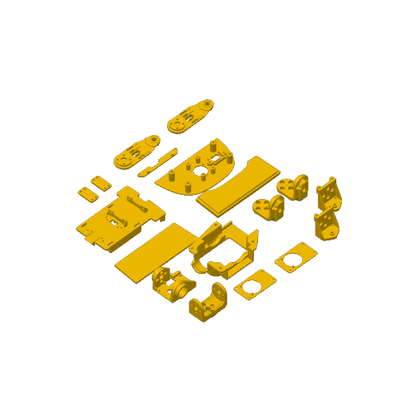<br><sub>盘 4</sub></td>
<td align="center"><br><sub>盘 5</sub></td>
</tr>
</table>

**怎么用**：先核对舵机版本、所需零件与材料，再用 Bambu Studio 打开工程、检查排盘并切片。软下巴、软嘴顶部与轮胎等柔性件应按 BOM 使用 TPU，不能统一按默认 PLA 打印。使用其他打印机时，应确认切片软件支持导入该 3MF，并按自己的机器重设打印参数。

耗材、螺丝、热熔螺母的采购在[主仓机械采购清单](https://github.com/fanhao375/microduck-replica/blob/master/docs/机械采购清单.md)。

---

## 组件清单（15 个）

| 序号 | 组件 | 英文 | 位置 / 功能 |
|---|---|---|---|
| 01 | 躯干主体 | Torso | 机身主体，**全部组件的装配基准件**，承载左/右腿、颈部与控制器 |
| 02 | 左髋 | Left Hip | 左腿根部髋关节（Pitch），腿部前后摆动 |
| 03 | 左髋 Roll | Left Hip Roll | 左腿髋部横滚关节，腿部侧向摆动 |
| 04 | 左大腿 | Left Thigh | 连接髋关节与小腿 |
| 05 | 左小腿 | Left Calf | 连接大腿与踝关节 |
| 06 | 左踝脚 | Left Ankle & Foot | 踝关节及脚部，足部转动与支撑 |
| 07 | 颈根 | Neck Base | 颈部与机身连接处的旋转底座（Yaw） |
| 08 | 颈俯仰 | Neck Pitch | 颈部俯仰摆动关节 |
| 09 | 头 Yaw / Roll | Head Yaw / Roll | 头部水平摆动与横滚关节 |
| 10 | 头部总成 | Head Assembly | 头部完整组件，含外壳、摄像头等 |
| 11 | 右髋 | Right Hip | 与 02 镜像对称 |
| 12 | 右髋 Roll | Right Hip Roll | 与 03 镜像对称 |
| 13 | 右大腿 | Right Thigh | 与 04 镜像对称 |
| 14 | 右小腿 | Right Calf | 与 05 镜像对称 |
| 15 | 右踝脚 | Right Ankle & Foot | 与 06 镜像对称 |

## 装配顺序

**按编号 01 → 15 依次装，就是推荐的整机装配顺序：**

```
1.  01           躯干主体 —— 作为整机基准先行固定
2.  02 → 06      左腿   左髋 → 左髋Roll → 左大腿 → 左小腿 → 左踝脚
3.  07 → 10      颈头   颈根 → 颈俯仰 → 头Yaw/Roll → 头部总成
4.  11 → 15      右腿   右髋 → 右髋Roll → 右大腿 → 右小腿 → 右踝脚
```

**每一步的详细步骤、配图和注意事项，见** [装配安装说明书 PDF](安装说明书/microduck装配安装说明书.pdf)。

## 装配视频教程

**[B 站合集《MicroDuck 从零安装教程》](https://space.bilibili.com/312747174/lists/9279084?type=season)** —— 机械行者Robo 录的，从零件清单讲起，一集装一个部件。视频是先把腿、躯干、颈、头各自装成组件，跟上面按编号的整机顺序不完全一样，两边对照着看。共 8 集，截至 2026-10-12 已更新 6 集：

| 集 | 内容 | 时长 |
|---|---|---|
| [第 1 集](https://www.bilibili.com/video/BV1RoHX68EFV/) | 零件清单：头部、颈部、左右腿、脚掌各组件和舵机配件 | 1:32 |
| [第 2 集](https://www.bilibili.com/video/BV1Xppb6tECr/) | 小腿安装 | 2:21 |
| [第 3 集](https://www.bilibili.com/video/BV1ycpb6yEwB/) | 大腿安装 | 5:13 |
| [第 4 集](https://www.bilibili.com/video/BV1Kwpg6wE9G/) | 躯干组件安装 | 2:29 |
| [第 5 集](https://www.bilibili.com/video/BV1EEpg6nEkD/) | 颈部安装 | 0:40 |
| [第 6 集](https://www.bilibili.com/video/BV1aKpE6hEzj/) | 头部安装 | 5:50 |

---

## 组件图

<table>
<tr>
<td align="center">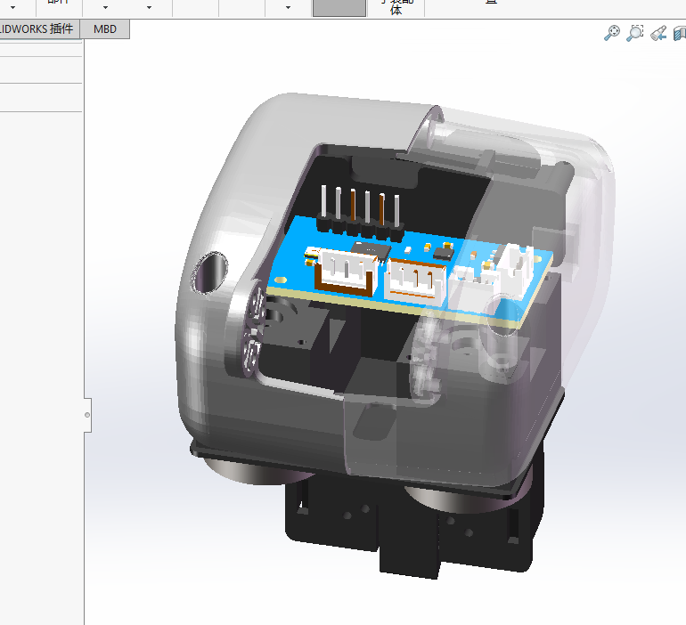<br><sub><b>01</b> 躯干主体</sub></td>
<td align="center">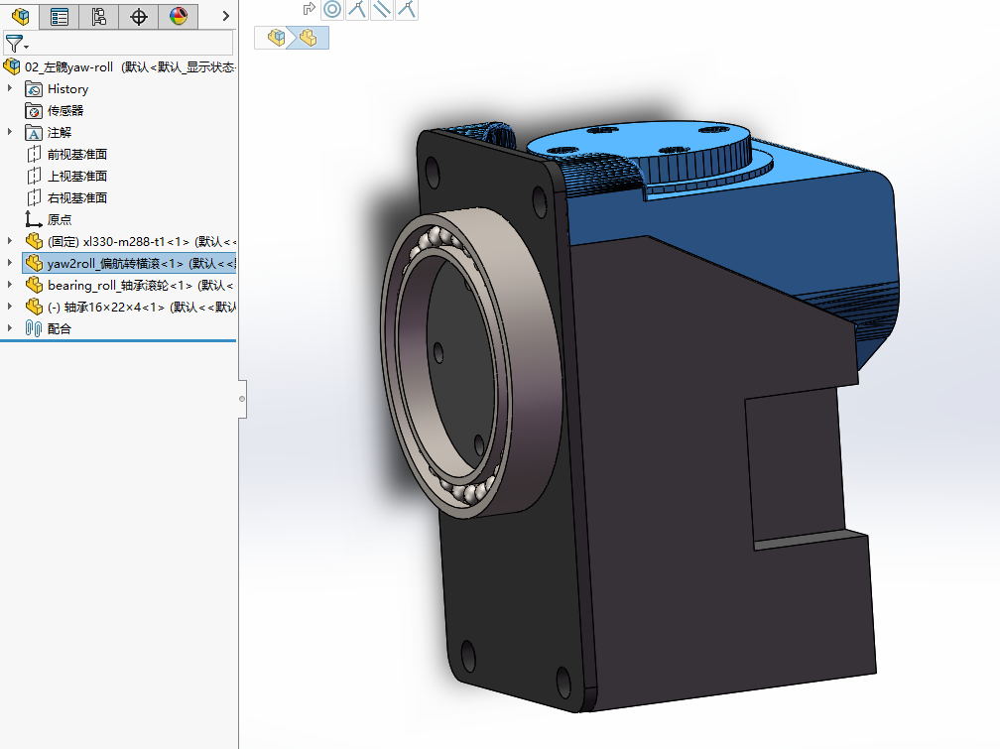<br><sub><b>02</b> 左髋</sub></td>
<td align="center">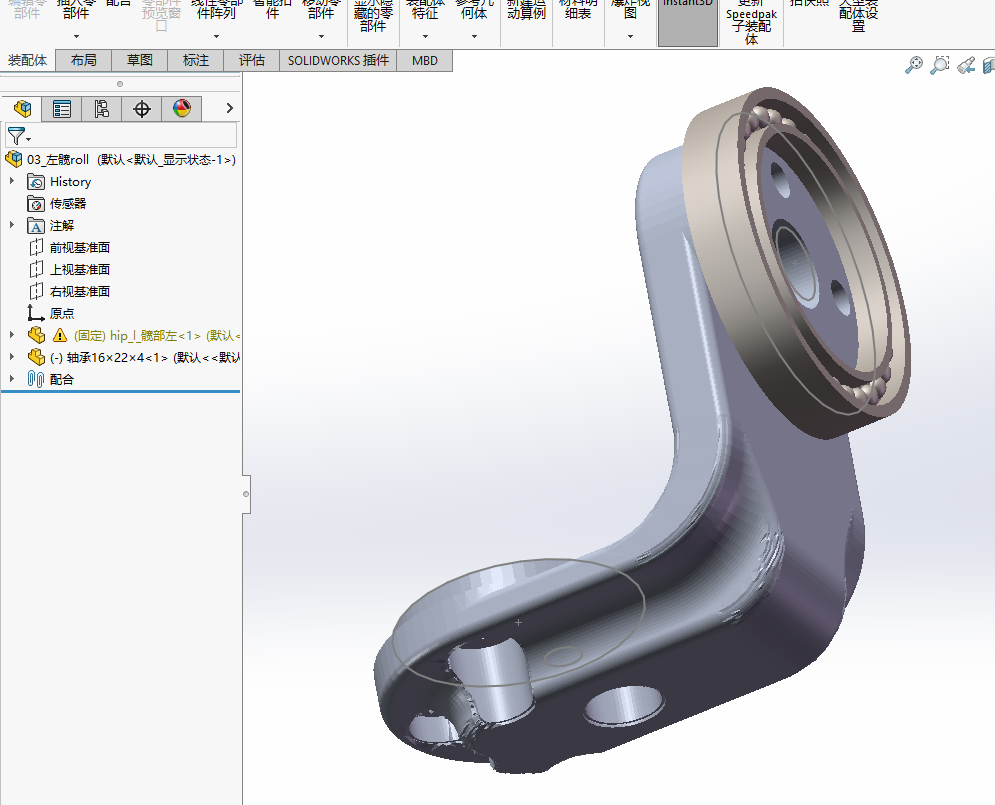<br><sub><b>03</b> 左髋 Roll</sub></td>
<td align="center">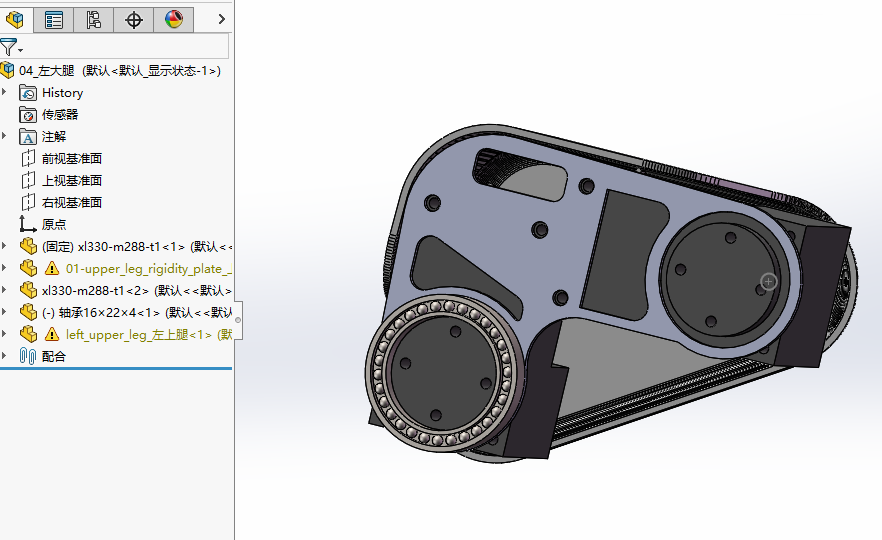<br><sub><b>04</b> 左大腿</sub></td>
</tr>
<tr>
<td align="center"><br><sub><b>05</b> 左小腿</sub></td>
<td align="center"><br><sub><b>06</b> 左踝脚</sub></td>
<td align="center"><br><sub><b>07</b> 颈根</sub></td>
<td align="center"><br><sub><b>08</b> 颈俯仰</sub></td>
</tr>
<tr>
<td align="center"><br><sub><b>09</b> 头 Yaw/Roll</sub></td>
<td align="center">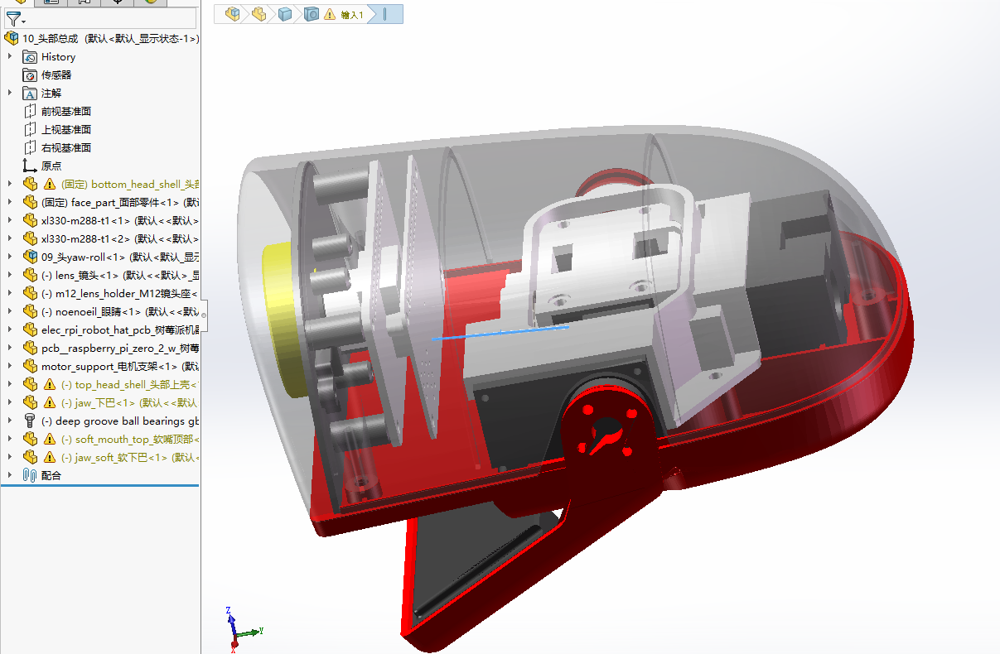<br><sub><b>10</b> 头部总成</sub></td>
<td align="center">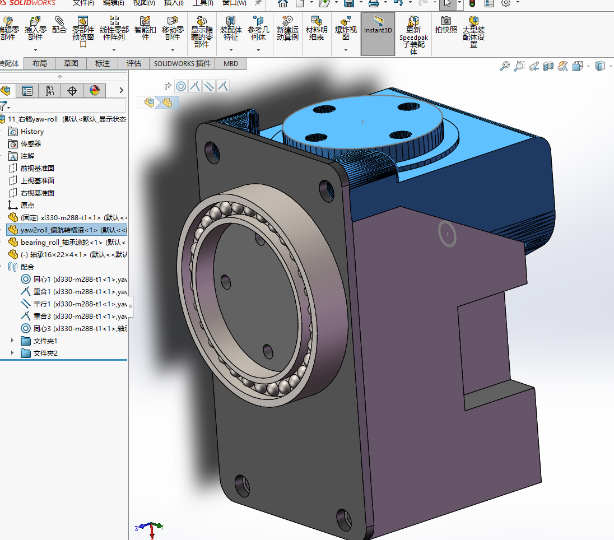<br><sub><b>11</b> 右髋</sub></td>
<td align="center"><br><sub><b>12</b> 右髋 Roll</sub></td>
</tr>
<tr>
<td align="center">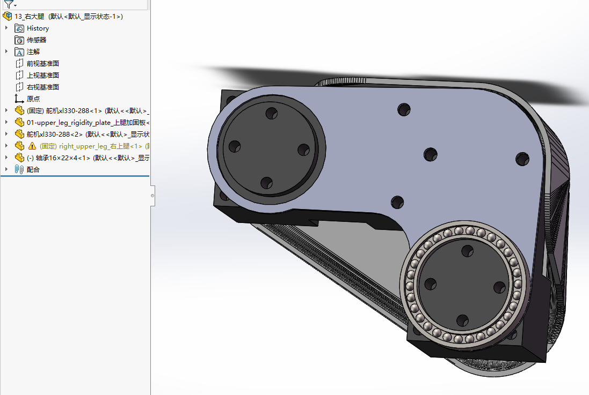<br><sub><b>13</b> 右大腿</sub></td>
<td align="center">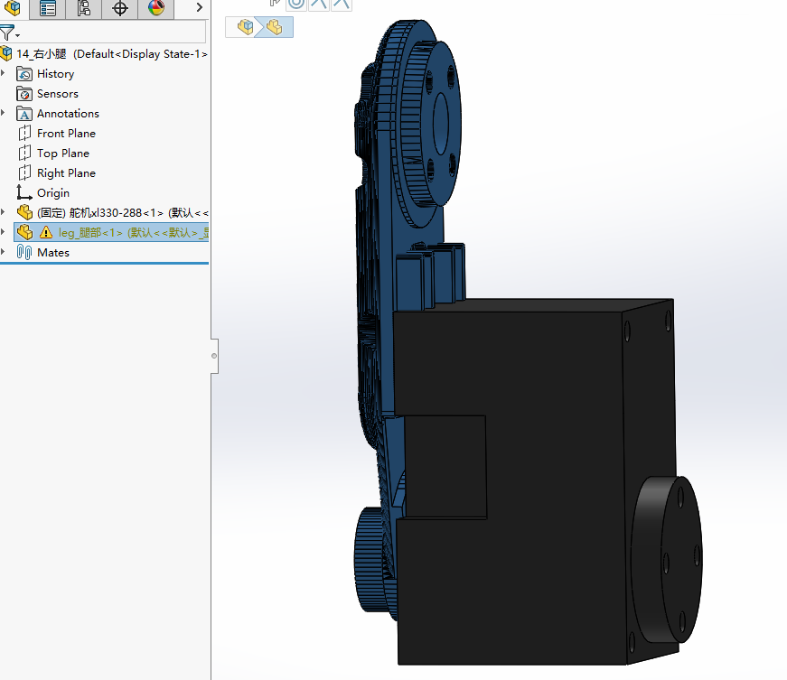<br><sub><b>14</b> 右小腿</sub></td>
<td align="center">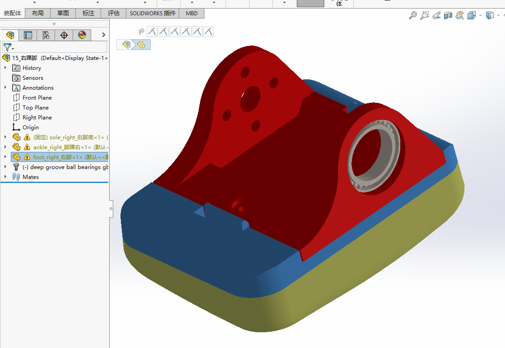<br><sub><b>15</b> 右踝脚</sub></td>
<td align="center">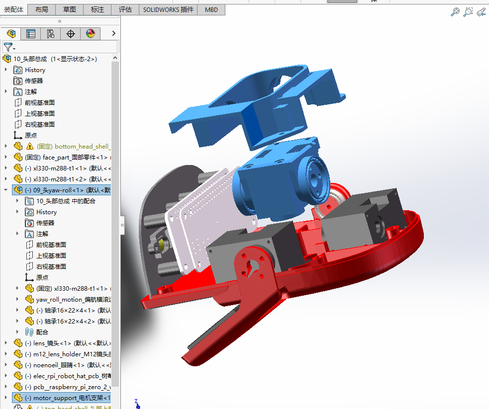<br><sub>头部总成（爆炸）</sub></td>
</tr>
</table>

<div align="center">
  <br>
  <sub>全部零件总览</sub>
</div>

---

## 文件清单

### 装配体（16 个 `.SLDASM`）

`00-microduck装配体` 是总装，下面 15 个是分组件：

```
00-microduck装配体      70.3 MB      08_颈俯仰               0.3 MB
01_躯干主体             20.5 MB      09_头yaw-roll          0.7 MB
02_左髋yaw-roll         2.5 MB      10_头部总成             22.2 MB
03_左髋roll             3.8 MB      11_右髋yaw-roll         2.5 MB
04_左大腿               1.9 MB      12_右髋roll             3.8 MB
05_左小腿               1.9 MB      13_右大腿               2.0 MB
06_左踝脚               9.3 MB      14_右小腿               1.8 MB
07_颈根                 0.1 MB      15_右踝脚               9.3 MB
```

### 零件（40 个 `.SLDPRT`）

| 类别 | 零件 |
|---|---|
| **躯干 / 外壳** | `trunk_base_躯干底座` · `left_shell_左壳` · `right_shell_右壳` · `power_support_电源支架` · `banana_pcb_locker_香蕉形PCB锁扣` |
| **腿** | `leg_腿部` · `left_upper_leg_左上腿` · `right_upper_leg_右上腿` · `hip_l_髋部左` · `yaw2roll_偏航转横滚` · `yaw_roll_motion_偏航横滚运动` · `01-upper_leg_rigidity_plate_上腿加固板` |
| **踝 / 脚** | `ankle_left_脚踝左` · `ankle_right_脚踝右` · `foot_left_左脚` · `foot_right_右脚` · `sole_left_左脚底` · `sole_right_右脚底` |
| **颈 / 头** | `neck_颈部` · `neck_pitch_颈部俯仰` · `top_head_shell_头部上壳` · `bottom_head_shell_头部下壳` · `face_part_面部零件` · `jaw_下巴` · `jaw_soft_软下巴` · `soft_mouth_top_软嘴顶部` · `noenoeil_眼睛` |
| **摄像头** | `m12_lens_holder_M12镜头座` · `lens_镜头` |
| **电路板** | `3D_PCB1_2026-09-08`（imu_to_dxl，2026-09-08 版）· `elec_rpi_robot_hat_pcb_树莓派机器人HAT电路板` · `pcb__raspberry_pi_zero_2_w_树莓派Zero2W电路板` |
| **标准件 / 外购** | `舵机xl330-288` · `xl330-m288-t1` · `xl330-m288-t2` · `轴承16×22×4` · `bearing_roll_轴承滚轮` · `M2铜柱` · `motor_support_电机支架` · `np_f970_NPF970电池` |

### 两处命名要留意

- **`np_f970_NPF970电池`** —— 文件名沿用了上游的 `np_f970`，但**实物是 NP-F550**。
  主仓实测上游网格包围盒为 **70.8 × 38.6 × 20.6 mm**，正是 F550/F570 的尺寸；真 NP-F970 厚约 60 mm，
  **买错装不进去，而且 300 g 会吃掉整机预算的三分之一**。详见
  [主仓 BOM 的电池型号勘误](https://github.com/fanhao375/microduck-replica/blob/master/BOM.md)。
- **`pcb__raspberry_pi_zero_2_w`** —— 同样是上游的占位命名，**实机主控是 Radxa Zero 3W**（RK3566），
  只是外形同为 Pi Zero。见[主仓的硬件方案逆向](https://github.com/fanhao375/microduck-replica/blob/master/docs/硬件方案逆向.md)。

---

## 通用注意事项（摘自说明书）

- 装配前对照 BOM 清点零件数量与规格，确认 **M2 / M2.5** 螺丝与紧固件齐全
- **舵机类关节件：装配前先通电归中位再锁紧**，避免行程偏移
- 螺丝**对角分步预紧**，避免单边受力导致零件变形；塑料件切勿过度锁紧
- **左右对称件（髋 / 大腿 / 小腿 / 踝脚）务必区分左右**，切勿装反
- 线缆统一固定、预留关节活动余量，严禁压线、夹线、缠绕
- 每完成一个活动关节，转动测试一次，检查是否干涉、卡滞、异响
- 首次通电前检查所有电气连接、绝缘与极性

**推荐工具**：十字/内六角螺丝刀 · 镊子 · 螺纹胶 · 舵机中位调试工具或控制板。

---

## 声明与许可

> ⚠️ **这是第三方复刻件，不是官方设计。** 与 Pollen Robotics 无隶属关系，未获其背书。

本套图纸依据 [`pollen-robotics/microduck_rl`](https://github.com/pollen-robotics/microduck_rl) 公开发布的
STL 网格重建为可编辑的 SolidWorks 参数模型。上游 3D 模型许可为 **CC BY-NC-SA**，
因此本仓库的图纸作为衍生作品同样以 **[CC BY-NC-SA 4.0](https://creativecommons.org/licenses/by-nc-sa/4.0/deed.zh)** 发布：
**署名 · 非商业性使用 · 相同方式共享**。

- **图纸与说明书著作权归「机械行者Robo」**，转载与二次分发请保留署名
- 文档文字部分同样按 CC BY-NC-SA 4.0 发布
- Microduck 是 Pollen Robotics 的商业产品，本仓库不提供任何官方支持

**发现问题**请开 [issue](../../issues)，或到上面两个账号留言。
